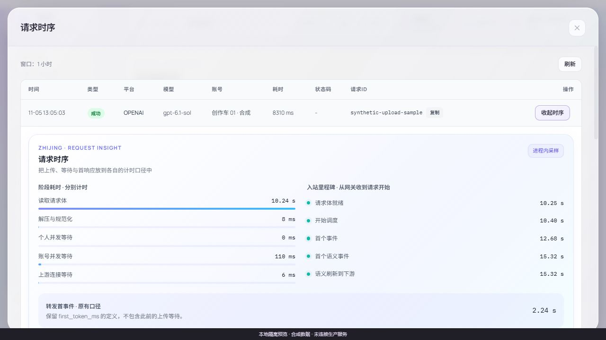

<picture>
  <source media="(prefers-color-scheme: dark)" srcset="docs/images/hero-dark.svg">
  
</picture>

<p align="center">
  <b>智境网关 · 会话稳固，等待可见</b><br>
  <sub>以液态玻璃、清晰排版和细腻交互，连接你的工具与创造。</sub>
</p>

<p align="center">
  
  
  <a href="https://github.com/daniei-chen/zhijing-gateway/releases/tag/v0.0.2"></a>
  <a href="docs/releases/v0.0.3.zh-CN.md"></a>
  <a href="https://github.com/daniei-chen/zhijing-gateway/actions/workflows/ci.yml"></a>
  <a href="LICENSE"></a>
</p>

<p align="center">
  <a href="#界面一览">界面一览</a> · <a href="#本地运行">本地运行</a> · <a href="#设计与交互">设计与交互</a> · <a href="#验证与兼容">验证与兼容</a>
</p>

智境提供登录、成员工作台与管理员控制台的统一前端。业务能力沿用 [Sub2API](https://github.com/Wei-Shaw/sub2api)，权限、计费与功能开关继续由后端决定。公开前端源码、合成预览、验证工具及明确版本的通用后端差异补丁。

> **上线状态**：v0.0.2 前端与后端已于 2026-11-05 完成上线，采用并行 API 实例与热切流量，保留在途请求和回退入口。GitHub 发布与生产验证分别记录，详见 [Release](https://github.com/daniei-chen/zhijing-gateway/releases/tag/v0.0.2)。本页截图继续使用合成数据，额度、价格、指标与有效期均为演示样例。

**版本下载**：[v0.0.2 · 会话有界，诊断有据](https://github.com/daniei-chen/zhijing-gateway/releases/tag/v0.0.2)，提供静态构建包、可选诊断源码包、构建清单和 SHA256；[更新说明](docs/releases/v0.0.2.zh-CN.md)。

## v0.0.3 候选 · 会话稳固，等待可见

<p align="center"><sub>SESSION / 持有有界　·　WORKSPACE / 按需展开　·　OBSERVABILITY / 等待可见</sub></p>

| 更稳固的会话 | 更从容的工作台 | 更细的首响应诊断 |
| :--- | :--- | :--- |
| 匹配后端支持 HttpOnly Cookie；OAuth 不再通过 URL 返回登录凭据，晚到结果绑定发起会话。 | 账号弹窗与重组件按需加载，设置草稿保留；图片轮询、缓存、下载和预览及时清理。 | 分开上游请求写完、首字节、首事件与有内容输出，保留原 TTFT 口径。 |

**当前是持续修复候选，未部署 v0.0.3，也未发布正式 Release。** 11 月 6 日冻结检查点 10 的 486 个文件、5,015 项测试、类型、全仓 ESLint 与静态构建通过；覆盖率为行 80.97%、语句 78.40%、函数 72.00%、分支 69.84%，后三项仍未达到原 80% 门槛。设置批次收尾、支付表单、账号列表、运维设置和兑换码弹窗已完成所列复验；顶部栏退出归属、备份确认与迟到反馈仍有已复现问题待修。CI 和打包脚本保留真实门槛，历史失败记录继续公开。

配套认证升级需要**先匹配后端，再更新前端**。新增原子撤销、认证存储启动检查及可选本机上传压缩；保留原 TTFT 口径，尚无生产长尾消除的实测结论。详见[最新修复与门禁](docs/reviews/2026-11-06-v003-followup.zh-CN.md)、[候选更新说明](docs/releases/v0.0.3.zh-CN.md)、[匹配后端补丁](integrations/sub2api/v0.0.3/README.zh-CN.md)。

## v0.0.2 · 已发布的工作台基础

| 连接的边界 | 这一版的行为 |
| :--- | :--- |
| 每次操作有归属 | 请求、刷新、重试与状态写回绑定会话；换号后清除旧页面缓存。 |
| 嵌入不传登录凭证 | iframe 与新窗口不再携带原登录 token，回调查询参数也不进入来源追踪。 |
| 等待可以解释 | 上传、规范化、并发等待与首事件分别计时，缺失保持“未采集”。 |
| 发布可以复验 | 全量回归、保留原始兼容基线、根级 CI、来源与产物摘要。 |

<picture>
  <source media="(prefers-color-scheme: dark)" srcset="docs/images/v0.0.2-request-timing-dark.jpg">
  
</picture>

阶段耗时与累计里程碑使用各自口径，原有 `first_token_ms` 保留；真实零等待与未采集清楚区分。前端兼容旧后端，完整阶段数据需要匹配的[可选诊断补丁](integrations/sub2api/README.zh-CN.md)。

依赖旧嵌入 `token` 参数的服务需要迁移。本版本先停止传原登录凭证；短时、单次兑换票据仍需后端与接收方联调，详见[安全修复与核实记录](docs/reviews/2026-11-05-security-followup.zh-CN.md)。

## 界面一览

### 一眼掌握，运行有序

运维概览、实时指标和系统状态采用统一的层次与材质。数据区域保持清晰，玻璃效果集中在导航、控件和浮层。

<picture>
  <source media="(prefers-color-scheme: dark)" srcset="docs/images/admin-ops-dark.png">
  
</picture>

<table>
  <tr>
    <td width="50%"><b>成员与业务</b><br><sub>筛选、固定列、选择与行操作，保持熟悉的操作方式。</sub></td>
    <td width="50%"><b>轻盈而清晰的弹窗</b><br><sub>统一表单、按钮与焦点反馈，复杂配置也有秩序。</sub></td>
  </tr>
  <tr>
    <td></td>
    <td></td>
  </tr>
</table>

## 设计与交互

| 体验 | 具体实现 |
| :--- | :--- |
| **液态玻璃** | 紫、蓝、青光场，细高光边缘与柔和内阴影；浅色和深色保持一致。 |
| **有层次的数据** | 表格保留清晰底色、固定列与虚拟滚动，选中和悬停状态同步呈现。 |
| **细腻的反馈** | 按钮按压、导航滑块、切页与弹窗过渡；支持暂停及系统减少动态效果。 |
| **键盘与窄屏** | 顶层弹窗焦点循环、Escape 关闭和焦点恢复；手机表格切换卡片，输入字号 16px。 |
| **统一管理入口** | 24 个管理页面覆盖运维、成员、订阅、账号、渠道、用量、订单、风控与设置。 |

<details>
  <summary><b>查看 320px 窄屏弹窗</b></summary>
  <p align="center"></p>
</details>

## 本地运行

使用 Node.js 24、pnpm 9.15.9 与 Python 3。首次安装请在独立克隆目录执行。

```bash
git clone https://github.com/daniei-chen/zhijing-gateway.git
cd zhijing-gateway/frontend
pnpm install --frozen-lockfile
pnpm build
cd ..
python qa/preview_server.py --port 18872
```

打开 [本地预览入口](http://127.0.0.1:18872/__preview)，选择登录页、成员工作台或管理员控制台。

| 入口 | 地址 |
| :--- | :--- |
| 管理员演示 | `http://127.0.0.1:18872/__preview/admin` |
| 成员演示 | `http://127.0.0.1:18872/__preview/member` |
| 登录页面 | `http://127.0.0.1:18872/login` |

演示服务只监听本机，使用合成身份与接口；页面会显示隔离预览横幅。业务写入被阻止，演示不会连接真实网关、模型、邮件或支付服务。演示账户为 `admin@preview.local` / `member@preview.local`，演示密码为 `Preview2026!`。

## 验证与兼容

当前 v0.0.3 候选的结果见[机器可读验证摘要](docs/validation-v0.0.3.json)。[严格审计报告](docs/reviews/2026-11-05-strict-audit.zh-CN.md)记录继承的安全、依赖与性能修复；其历史计数不改写为本轮结果。下面的 v0.0.2 数据保留原发布口径。

v0.0.2 前端全量回归 **392 个文件、3,139 项测试通过**；原四条失败的安全验收全部转为通过。真实客户端、认证 API 与状态仓库的合成往返覆盖不同 HTTP 方法、晚到结果、同账号重新登录、刷新与会话切换。本地浏览器验证双标签管理员到成员切换、浅/深色时序面板、320/390px 和关闭后焦点恢复。

V6 原有 24 个管理入口的视觉验收作为基础保留；本轮没有把其余移动排序、启动恢复或 OTP 易用性待办宣称全部修复。详细范围见[验证摘要](docs/validation-v0.0.2.json)。

```bash
cd frontend
pnpm typecheck
pnpm lint:check
pnpm test:coverage --maxWorkers=4
# 当前四项覆盖率不足会退出 1；构建和下列检查可以分别执行。
pnpm build
cd ..
python tools/verify_frontend.py
node tools/verify_ops_contract.mjs
python integrations/sub2api/check_patch.py --artifact-only
python integrations/sub2api/check_patch.py --bundle v0.0.3 --artifact-only
```

- 原 227 文件兼容基线保留；v0.0.2、严格审计与 v0.0.3 的变更分别通过明确摘要链登记，未静默重建基线。Ops 契约明确包含已批准的运行时变化。
- 68 条路由声明与两份运行时法律文本保持；原 API 路径、服务端权限、额度与计费继续生效。
- 构建资源使用 `/app-assets/`，与官网 `/assets/` 分离。
- `frontend/dist/` 仅为静态前端，演示注入与合成身份不进入构建。

这些检查说明前端与隔离演示的验证范围；真实支付、发信、供应商推理和生产切换需按实际环境分别验收。

## 工程结构

```text
frontend/              Vue、TypeScript、样式与组件测试
  src/styles/          智境设计语言与各版本表现层
  public/app-assets/   本地托管字体与品牌资源
qa/                    本机合成数据预览
integrations/sub2api/  历史诊断补丁、v0.0.3 配套会话补丁与摘要核验
tools/                 契约、构建、发布包及下载校验
docs/                  设计、验证、界面图片和字体许可
```

接入既有网关时保持原 API 路由，先验证匹配后端与静态资源，再选择发布窗口并保留旧哈希资源。更新安全版本时应完整刷新旧标签；v0.0.3 认证变更要求后端先升级。完整后端不包含在本工程中，补丁只适用于明确匹配的自定义源码，不应直接套用原版 Sub2API。

## 来源与许可

业务前端基于 [Wei-Shaw/sub2api](https://github.com/Wei-Shaw/sub2api) 的 `d851a38477597157e78450d30af2d8504764d085` 及既有智境登录外壳演进。原 [LICENSE](LICENSE)、[CLA](CLA.md) 与上游法律文本保留，遵循 LGPL v3。

Manrope、Noto Sans SC 与 IBM Plex Mono 的 OFL 文本见 [字体许可](docs/font-licenses)。封面为项目自有 SVG 表现层；界面中的品牌标识与字体来源见 [资源说明](docs/ASSETS.zh-CN.md)。

<p align="center"><sub>ZHIJING / 让复杂留给系统，让智能回归创造。</sub></p>
