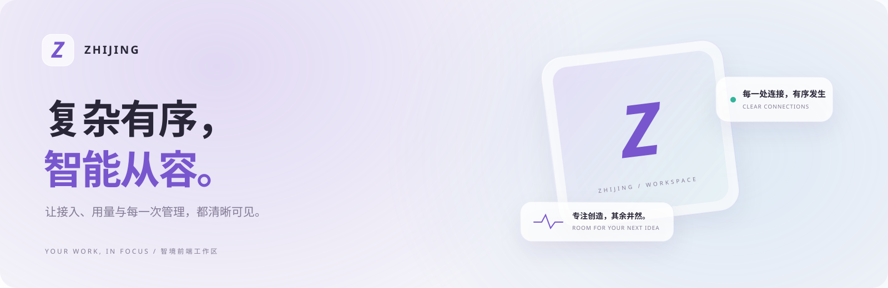
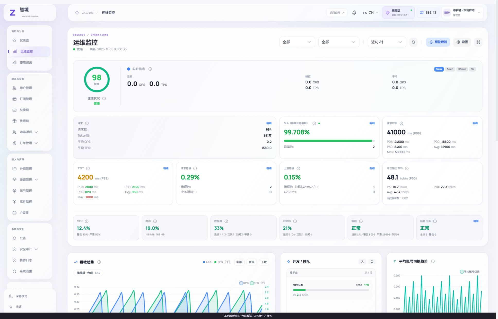
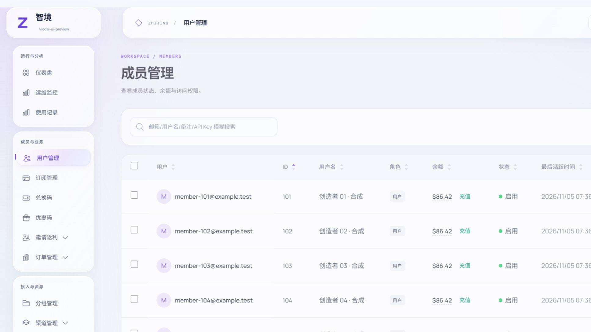
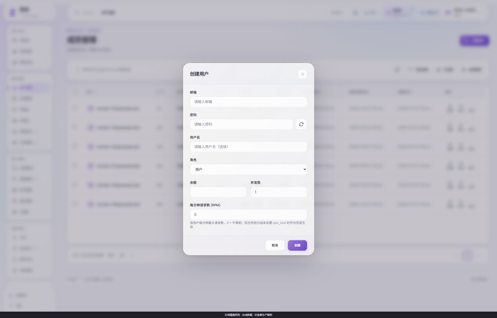
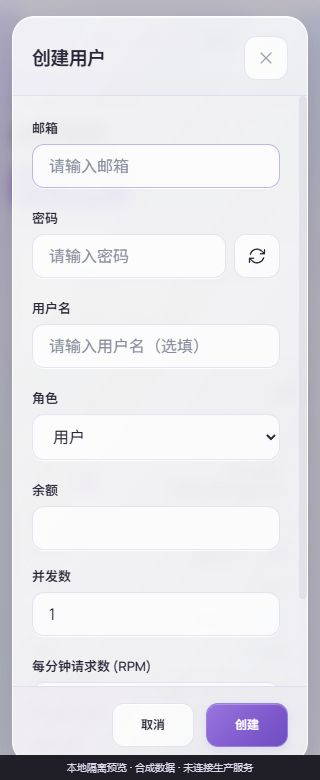

<picture>
  <source media="(prefers-color-scheme: dark)" srcset="docs/images/hero-dark.svg">
  
</picture>

<p align="center">
  <b>智境网关 · 登录与工作台前端</b><br>
  <sub>以液态玻璃、清晰排版和细腻交互，连接你的工具与创造。</sub>
</p>

<p align="center">
  
  
  
  <a href="LICENSE"></a>
</p>

<p align="center">
  <a href="#界面一览">界面一览</a> · <a href="#本地运行">本地运行</a> · <a href="#设计与交互">设计与交互</a> · <a href="#验证与兼容">验证与兼容</a>
</p>

智境提供登录、成员工作台与管理员控制台的统一前端。业务能力沿用 [Sub2API](https://github.com/Wei-Shaw/sub2api)，认证、权限、计费与功能开关继续由原后端决定。本仓库包含前端源码、隔离演示与验证工具。

> **当前进展**：V5 登录与成员工作台已上线；V6 管理员内部玻璃化已完成本地验收，尚未替换线上。下方截图来自合成数据预览，额度、价格与有效期均为演示样例。

## 界面一览

### 一眼掌握，运行有序

运维概览、实时指标和系统状态采用统一的层次与材质。数据区域保持清晰，玻璃效果集中在导航、控件和浮层。

<picture>
  <source media="(prefers-color-scheme: dark)" srcset="docs/images/admin-ops-dark.png">
  
</picture>

<table>
  <tr>
    <td width="50%"><b>成员与业务</b><br><sub>筛选、固定列、选择与行操作，保持熟悉的操作方式。</sub></td>
    <td width="50%"><b>轻盈而清晰的弹窗</b><br><sub>统一表单、按钮与焦点反馈，复杂配置也有秩序。</sub></td>
  </tr>
  <tr>
    <td></td>
    <td></td>
  </tr>
</table>

## 设计与交互

| 体验 | 具体实现 |
| :--- | :--- |
| **液态玻璃** | 紫、蓝、青光场，细高光边缘与柔和内阴影；浅色和深色保持一致。 |
| **有层次的数据** | 表格保留清晰底色、固定列与虚拟滚动，选中和悬停状态同步呈现。 |
| **细腻的反馈** | 按钮按压、导航滑块、切页与弹窗过渡；支持暂停及系统减少动态效果。 |
| **键盘与窄屏** | 顶层弹窗焦点循环、Escape 关闭和焦点恢复；手机表格切换卡片，输入字号 16px。 |
| **统一管理入口** | 24 个管理页面覆盖运维、成员、订阅、账号、渠道、用量、订单、风控与设置。 |

<details>
  <summary><b>查看 320px 窄屏弹窗</b></summary>
  <p align="center"></p>
</details>

## 本地运行

使用 Node.js 24、pnpm 9.15.9 与 Python 3。首次安装请在独立克隆目录执行。

```bash
git clone https://github.com/daniei-chen/zhijing-gateway.git
cd zhijing-gateway/frontend
pnpm install --frozen-lockfile
pnpm build
cd ..
python qa/preview_server.py --port 18871
```

打开 [本地预览入口](http://127.0.0.1:18871/__preview)，选择登录页、成员工作台或管理员控制台。

| 入口 | 地址 |
| :--- | :--- |
| 管理员演示 | `http://127.0.0.1:18871/__preview/admin` |
| 成员演示 | `http://127.0.0.1:18871/__preview/member` |
| 登录页面 | `http://127.0.0.1:18871/login` |

演示服务只监听本机，使用合成身份与接口；页面会显示隔离预览横幅。业务写入被阻止，演示不会连接真实网关、模型、邮件或支付服务。演示账户为 `admin@preview.local` / `member@preview.local`，演示密码为 `Preview2026!`。

## 验证与兼容

V6 已完成 **24 个管理入口**的本地浏览器检查，覆盖浅色、深色、中英文、390px 与 320px 窄屏；组件回归 **41 个文件、207 项测试通过**。表格选择、排序反馈、下拉菜单、危险操作取消、弹窗焦点循环与减少动态效果均有实际验证。

```bash
cd frontend
pnpm typecheck
pnpm test:run
pnpm build
cd ..
python tools/verify_frontend.py
```

- 227 个 API、状态、路由、类型及工具文件保留原契约，68 条路由声明保持。
- 管理页面业务脚本与事件保持；共用弹窗增加键盘焦点辅助。
- 构建资源使用 `/app-assets/`，与官网 `/assets/` 分离。
- `frontend/dist/` 仅为静态前端，演示注入与合成身份不进入构建。

这些检查说明前端与隔离演示的验证范围；真实支付、发信、供应商推理和生产切换需按实际环境分别验收。

## 工程结构

```text
frontend/              Vue、TypeScript、样式与组件测试
  src/styles/          智境设计语言与各版本表现层
  public/app-assets/   本地托管字体与品牌资源
qa/                    本机合成数据预览
tools/                 前端契约与构建检查
docs/                  设计、验证、界面图片和字体许可
```

接入既有网关时，保持原有 API 路由与认证配置，先验证静态资源，再切换 HTML 入口并保留旧哈希资源。后端不包含在本前端工程中。

## 来源与许可

业务前端基于 [Wei-Shaw/sub2api](https://github.com/Wei-Shaw/sub2api) 的 `d851a38477597157e78450d30af2d8504764d085` 及既有智境登录外壳演进。原 [LICENSE](LICENSE)、[CLA](CLA.md) 与上游法律文本保留，遵循 LGPL v3，不将上游工程声明为原创 MIT 项目。

Manrope、Noto Sans SC 与 IBM Plex Mono 的 OFL 文本见 [字体许可](docs/font-licenses)。封面为项目自有 SVG 表现层；界面中的品牌标识与字体来源见 [资源说明](docs/ASSETS.zh-CN.md)。

<p align="center"><sub>ZHIJING / 让复杂留给系统，让智能回归创造。</sub></p>
