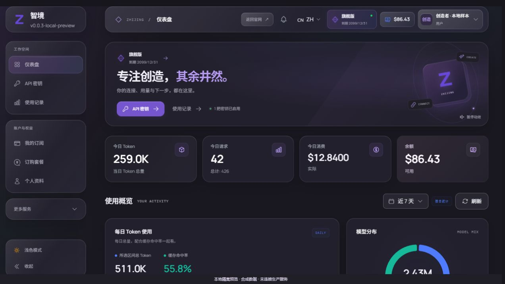
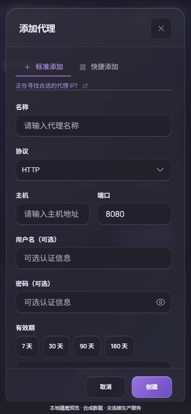

# v0.0.3 · 操作有归属，状态有依据

本记录承接 [11 月 5 日候选检查点](2026-11-05-v003-repair.zh-CN.md)。用户已授权继续修复前后端、界面与近期日志问题，反复交叉审阅，并在原发布门禁通过后上线、发布新版。**本轮仍在迭代，尚未部署 v0.0.3、创建正式标签或发布正式 Release。**

## 交付检查点 11 与暂停

按用户节省额度的选择，交付当前候选后暂停新增排查。1,112 个输入保持冻结；492 文件、5,168 项中 5,167 通过、1 项失败。失败是兑换码弹窗第二次 Escape 的关闭检查，该项独立运行通过（其余18项未选择），不能替代整仓成功；未生成有效的新覆盖率，仍保留检查点10原门槛缺口。[本轮完整结果](../proofs/v0.0.3-followup/frontend-validation-checkpoint-11.json)

本轮修复包含设置提交/OTP快照和新草稿保留、顶部栏退出归属、备份操作竞争与409提示、随机TLS选项保留、共用OTP弹窗的晚到反馈归属。应用源类型、ESLint及构建通过；原样备份独立检查17/17通过。另一组设置独审14项因Pinia夹具初始化失败未进入业务断言，备份附加测试的私人类型配置仍有15项错误输出，均未隐去或继续扩项修复。

匹配后端为 `dcaf707…`：85文件通用补丁，64执行包、12,561顶层测试、25,214含子例通过事件；vet、181文件匹配内嵌构建通过。干净基线竞态复验12唯一包、49执行包事件、1,238顶层通过、2,338含子例通过事件、14条件跳过，五批均退出0；保留全部原1,248名称并增加4个请求校验名称。非法备份参数在启动业务前拒绝，空/缺省14天、0永久及合法正整数兼容。[当前后端摘要](../proofs/v0.0.3-followup/backend-artifact-dcaf707-summary.json)

**本轮未上线、未创建正式标签或Release。** 原覆盖率门槛、失败记录及待验收事项保留；恢复后再处理，不以“完美无瑕”描述候选。下文检查点10按历史口径保留，其83文件产物可在提交e29d44c复原；当前公开差异为85文件。

## 已验证的修复

| 边界 | 处理与证据范围 |
| :--- | :--- |
| 会话撤销 | Redis 原子轮转只消费一次；全用户代际与单会话撤销阻止旧 JWT、并发刷新与旧 RT 恢复会话。已消费 RT 的只读别名只用于撤销，不能刷新。读取或撤销写入失败保持失败，不能用一次无操作覆盖错误并返回成功。 |
| 绑定与长连接 | OAuth 绑定复用已有 IP／UA 校验；数据库等待后再次验证撤销状态。管理员 WebSocket 定时检查当前权限、会话、过期和管理员密钥，关闭已失效连接。 |
| 混合退出凭据 | 有效 JWT 与可解析 RT 属于不同用户／会话时，在任何撤销前返回 400；保留同会话轮转、过期 JWT 和无 JWT 的旧客户端行为。 |
| 认证状态存储 | 启动前要求 Redis `noeviction`、AOF、`appendfsync always` 与重写期间持续 fsync；检查持久化状态。无权限、缺字段或检查失败阻止新 API 实例启动。专用短连接池同时处理总截止时间与提前取消，不改变业务池超时。 |
| 账号与 OAuth 表单 | 保存、认证交换、文件读取、状态与加载反馈绑定发起弹窗；取消、重开、换目标后不写回新草稿。字段名称与动态行 ID 唯一，关闭的批量编辑区使用原生禁用语义。 |
| 用量与代理选择 | 区分主动查询、被动批量结果与当前账号。代理测试绑定端点、登录及打开代次；旧结果不覆盖新选项。可访问的选项和明确的 Escape 处理保留键盘操作。 |
| 代理管理 | 创建、更新、删除、导入、导出、质量检测与分批工作绑定原目标；旧导出不产生迟到下载。IPv6 和包含特殊字符的认证信息可复制、导入往返。手机表单头部换行。 |
| 批量图片 | 任务行、详情、下载及重试保留发起 API Key；旧任务不借用当前选中的另一把 Key。空 Key 状态结束加载，换登录后的旧任务停止继续。 |
| 完整重试来源与下载清理 | 完整读取归属明确的历史和分项，保留隐藏祖先，拒绝不完整或歧义数据。新重试从当前可见任务进入，明确仅恢复 prompt。下载在创建、挂载、点击或移除链接异常时仍释放本次 Blob URL；嵌套下载资源独立。 |
| 共享控件 | 下拉清空使用真正按钮，保留 Delete／Backspace、活动选项声明及本字段焦点；父组件已移走焦点或已卸载时不抢回。Cookie 请求的晚到 401 复用同会话轮转选择符，其他旧错误也不能触发新会话的全局提示。 |
| 引导与导航 | 引导等待、driver、控制注册与已读标记均有会话／实例归属；跨页保留有效引导，换登录销毁旧引导。重叠手机导航共享滚动锁与外部焦点，旧计时器不关闭新的顶层抽屉。 |
| 设置与分组 | 字段与标签正确关联；分组异步详情不串入其他草稿。CAPTCHA 凭据保存后清空已提交明文，后续无关保存不重复提交旧秘密。 |
| 成员余额与订阅操作 | 余额、单项订阅调整和批量订阅的未知结果重试只查询已保存结果，复用原键、目标和请求；缺少确认、结果过期或旧后端不支持时，不退回新的业务写入。批量弹窗的表单、天数与提示 ID 按实例隔离，原生确认按钮只提交本弹窗的目标。 |
| 密钥有效期与配额 | 仅修改名称保留原到期时间的秒／毫秒精度。开启到期设置后拒绝空值和新建过去日期；配额重置更新当前行，旧列表不能覆盖已完成的变更。 |
| 渠道价格与折叠卡 | 保留既存空平台字段“适用任意平台”的后端语义；新建规则继续使用所属平台默认值。折叠按钮支持原生键盘操作，关闭内容退出焦点顺序。 |
| 版本与复制反馈 | 长请求、重启倒计时及健康探测绑定页面、登录和权限；明确拒绝重启时保留重试，不伪装为重启成功。复制反馈绑定原命令、版本及部署方式。 |
| 成员列表失败 | 用量、错误明细和订单加载失败时展示错误及当前条件重试，隐藏旧列表、分页和订单操作。新 CSV 导出不能借用加载中或失败的旧数据；已经启动的导出保留原筛选快照。 |
| 账号配额提交 | API Key 创建也进入原有统一收尾，使已填写的总量、日／周额度、重置与通知字段进入原 extra；普通凭据与其他请求字段保持。保存期间使用原生禁用语义，取消入口仍可使用。 |
| 设置与运维批次收尾 | 并行保存要等本批全部请求结束后才释放锁，首个失败不能提前允许新批次。保留原请求并行、数值单位与空值合同；四个运维 PUT 仍不具有事务或回滚语义。OIDC 时钟偏差的整数／范围校验与后端一致，保留 0 的既存含义。 |
| 支付与兑换码弹窗 | 支付表单、标签及秘密显示按钮按实例隔离。兑换码三个手写外壳迁移到共用玻璃弹窗，保留原 51 项业务断言与表单；嵌套下拉框已消费的 Escape、输入法组合输入不会再误关外层。 |
| 账号与兑换码列表 | 读取失败不展示旧结果；下载、批量操作、待完成删除与反馈保留发起目标及登录归属。取消只读扫描可以释放扫描锁，已发送的写操作仍等待自己的结果，不能宣称关闭弹窗会撤回服务端操作。 |
| 账号与运维 API 合同 | 实际客户端通过合成 Axios adapter 验证 Go 路由、DTO、空值及单位。单账号 PUT 类型移除后端不支持的调度字段；专用调度 POST、批量合同与运行请求保持。未将合成传输测试当成真实服务端业务 E2E。 |

这些是具体复现后的修复，不代表所有业务路径均已验证。所列设置、支付、账号、运维及兑换码修复已完成有范围的独立复验并纳入下面的整仓检查；没有执行真实付款或供应商推理。后续审查仍复现了顶部栏退出和备份页面的问题，继续作为未解决项保留。

## 冻结检查点 10

本检查点记录了一份 1,106 文件的[前端源码摘要快照](../proofs/v0.0.3-followup/frontend-source-checkpoint-10.json)。检查点 08 与之前的验证口径保留；检查点 09 的 4,915 项中有 1 项因缺少 `common.retry` 翻译失败，且未生成有效标准覆盖率报告。补齐中英文翻译后，本次重新完整执行；[09 失败记录](../proofs/v0.0.3-followup/frontend-validation-checkpoint-09.json)没有被覆盖为成功。

| 检查 | 结果 |
| :--- | :--- |
| 前端完整回归 | 486 个测试文件，5,015 项通过；0 失败、0 待定。[实际结果](../proofs/v0.0.3-followup/frontend-validation-checkpoint-10.json) |
| 四项原覆盖率门槛 | 行 80.97%、语句 78.40%、函数 72.00%、分支 69.84%；后三项未达到 80%，命令退出 1。 |
| 静态检查与构建 | 检查点 10 的全仓 `vue-tsc --noEmit`、ESLint 与 `vite build --manifest` 通过，输入摘要前后相同。测量 manifest 属于额外构建文件。 |
| 工具与兼容契约 | Python 51 项中 50 通过、1 项因 Windows 符号链接权限条件跳过；另有 reparse-point 拒绝检查。Ops 工具 3 项通过；227 个受保护文件、接续原基线的 14 条逐项增量、68 条路由及两个后端补丁归档检查通过。 |
| 后端单元回归 | Go 1.27.3，`869d91f…` 的完整 `-tags unit -short ./...` 通过，64 个有执行包、12,557 个顶层测试、25,189 个含子测试通过事件；39 个测试事件跳过，另有 51 个无执行包报告 skip。 |
| 后端工具链 | 所列包 `go vet -tags unit` 通过，Linux amd64、CGO 关闭的主程序交叉构建通过。 |
| 定向交叉审查 | 认证、OAuth、WebSocket、Cookie、Redis 原子操作及启动检查已做屏障／真实回环 race 回归；不将 miniredis 当成真实磁盘持久性压测。 |
| 干净补丁复验 | 当前 83 文件补丁在独立 `4851ca9…` 基线应用并核对摘要。12 包扩大定向 race 通过：1,234 个顶层测试、2,313 个含子例通过事件、14 个既有条件跳过，0 失败、0 race。保留全部旧名称并加入所有变更测试文件的顶层测试，1,248 个不同名称均观察到；四个不相交名称批次均退出 0，包按唯一值计数，48 次执行包事件不算成 48 个包。 |
| 匹配 API 实例的构建 | 已恢复并独立核验原 181 文件内嵌树，使用 `-tags embed` 构建，相关 web 单元测试通过。二进制与逐文件输入摘要见[构建证据](../proofs/v0.0.3-followup/backend-api-peer-build.json)。此前无 embed 的编译检查不作为替换包。 |

后端完整回归发现并修正了三个测试夹具问题：Ollama 截止时间使用确定性变更；协议目录用唯一计数器隔离缓存场景；进程级堆内存检查放入独立测试子进程，仍保留 20,000 模型和原 8 MiB 上界。这些测试修正不改变生产模型路由、限额或计费。

扩大竞态验证还修正了 Gin 全局模式初始化、Grok 配额缓存完成等待和邮箱缓存返回共享指针的测试夹具。邮箱缓存替身现在像实际 Redis 解码一样返回值副本；原并发别名成功／冲突断言保留。先前失败日志仍保留，没有把新结果覆盖回旧候选记录。[完整回归摘要](../proofs/v0.0.3-followup/backend-full-unit-checkpoint-08-summary.json)与[干净补丁竞态摘要](../proofs/v0.0.3-followup/backend-artifact-869d91f-summary.json)分别说明范围。

受保护前端源码使用[14 条逐项摘要增量](../security-changes-v0.0.3-followup.json)，接续 `331948dc…`，保留原始基线、严格审计增量和首轮 v0.0.3 增量。后端检查点10公开83文件，当前 [85 文件通用差异](../../integrations/sub2api/v0.0.3/README.zh-CN.md)，包括已独立复验的完整重试来源摘要；私有完整源码及生产配置不进入公开仓库。

<table>
  <tr><td></td><td width="30%"></td></tr>
</table>

手机表单头部的说明已完整换行；协议下拉通过真实键盘选中 SOCKS5，关闭后焦点回到协议字段。截图只验证对应视图，不代表完整后台业务 E2E 或无障碍合规认证。

本次还在内置浏览器验证了兑换码生成弹窗：自动聚焦关闭按钮，Tab／Shift+Tab 循环，首次 Escape 关闭真实下拉框、再次 Escape 返回生成按钮。390px 页面没有横向溢出；320×568px 弹窗位于 12–308px 内，内容可滚动，键盘可到达底部操作。视口覆盖已恢复，未提交生成或删除。[有限观察记录](../proofs/v0.0.3-followup/redeem-dialog-browser-checkpoint-10.json)没有冒充整页无障碍认证或保存的截图证据。

此前检查点 06 的版本面板已在内置浏览器复验：320px 视口内边界为 15–271px，不再越界或被导航玻璃遮住；回退说明可以展开，Escape 返回触发按钮。该视图源码后续未变，截图仍保留原观察口径；没有执行更新、重启或版本回退。[观察范围与数值](../proofs/v0.0.3-followup/version-mobile-visual-044.json)

## 上传与 TTFT

新增可选的[本机上传压缩中转](../clients/upload-relay.zh-CN.md)，不读取或自动修改成员的客户端配置。24 项真实回环 HTTP 测试覆盖原字节往返、第一条 SSE、取消、截断、分帧、限额与不记录秘密。

一次合成测试的重复文本 JSON 从 5,500,012 字节压为 34,743 字节，解压后字节与 SHA 一致。它只说明该输入的网络字节节省，**不证明生产上传、模型推理或 TTFT 已改善**。图片和已压缩内容可能收益很小，独立连接也有建立成本。

最近只读聚合仍有大体积未压缩上传和响应头之后的首输出等待；不同请求、上下文和推理档位不能作为匹配对照。本轮没有更改模型、effort、提示词、服务档位、额度或并发，没有供应商推理速度基准。

## 发布前仍需完成

同机独立容器已完成一次小规模持久化冒烟：限制 64 MiB、0.25 CPU、无网络，每种策略 400 次 SET、4 并发、256 字节合成值。`everysec` 平均 0.070 ms，`always` 平均 2.146 ms、P99 15.887 ms。同步策略确认写入的撤销标记在容器 SIGKILL 后重启仍保留，AOF 状态正常，测试容器及其匿名卷已移除。[原始合成结果](../proofs/v0.0.3-followup/isolated-redis-lab.json)只支持这次小规模验证，不能外推生产容量或网关 TTFT；生产配置读回仍是 `everysec`。

- 修复顶部栏旧退出请求晚到时干扰新登录、备份二次验证期间提交草稿变化及迟到反馈等已复现问题；独立复核后重新运行全仓检查。
- 完成账号高级配置的正常工作流与实际后端字段合同核对，保留既有凭据、extra 和专用调度入口的语义。
- 达到原四项 80% 全局覆盖率门槛，保留真实失败状态，不能下调门槛、排除生产代码或只调用私有函数制造通过。
- 补丁在干净匹配基线中应用、摘要与编译复验；正式包重新构建并校验来源、静态资源和归档内容。
- 按机器断言落实 Redis 运行条件，并监控共享实例真实开销；现网仍是 `everysec`，目前不满足新实例启动条件。
- 按同请求口径核验客户端上传与上游首输出；另一位成员电脑的适配需要实际客户端版本和能力信息。
- 先匹配后端再发前端，保留数据、限额和在途推理；旧后端不认识新撤销代际，不能让旧认证实例继续服务而宣称切换完成。

并行 API 角色必须精确为 `ZHIJING_API_ONLY=1`。缺失或写成 `true` 会走普通进程的启动清扫。旧实例的 TCP 数与共享槽位单独归零不能证明异步账本已经落盘；当前 5 秒 HTTP Shutdown 也不足以保证长流排空。入口切换后保留旧 peer，获得实例内请求、断连上游采集与用量队列的共同完成证据后再停止。

同步落盘也不能防止运维恢复旧备份。恢复前必须关闭认证入口，使旧 JWT、旧 RT／别名和待完成认证票据失效，再重新开放；只换 JWT 签名秘密仍可能留下可兑换的旧 RT。不得清空共享 Redis 或重启旧单例来清租约。[Redis 官方持久化说明](https://redis.io/docs/latest/operate/oss_and_stack/management/persistence/)区分了每秒落盘与回复前 fsync 的保证和成本。
